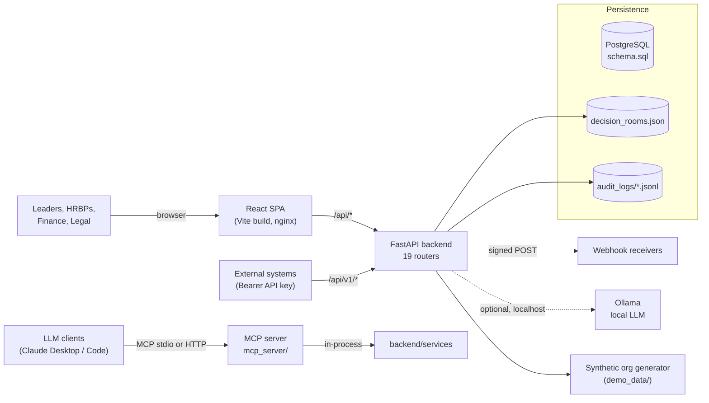
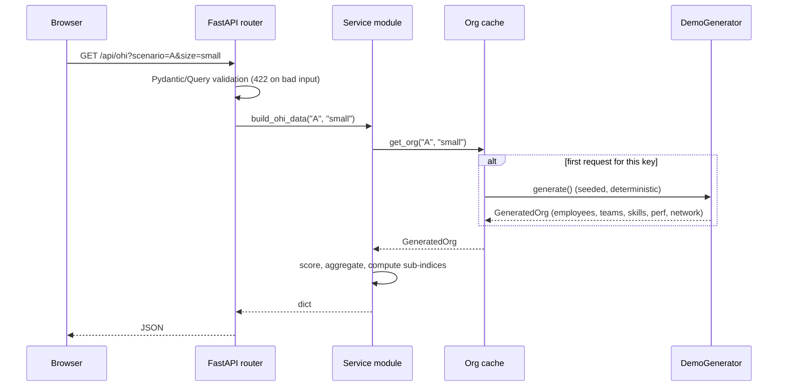
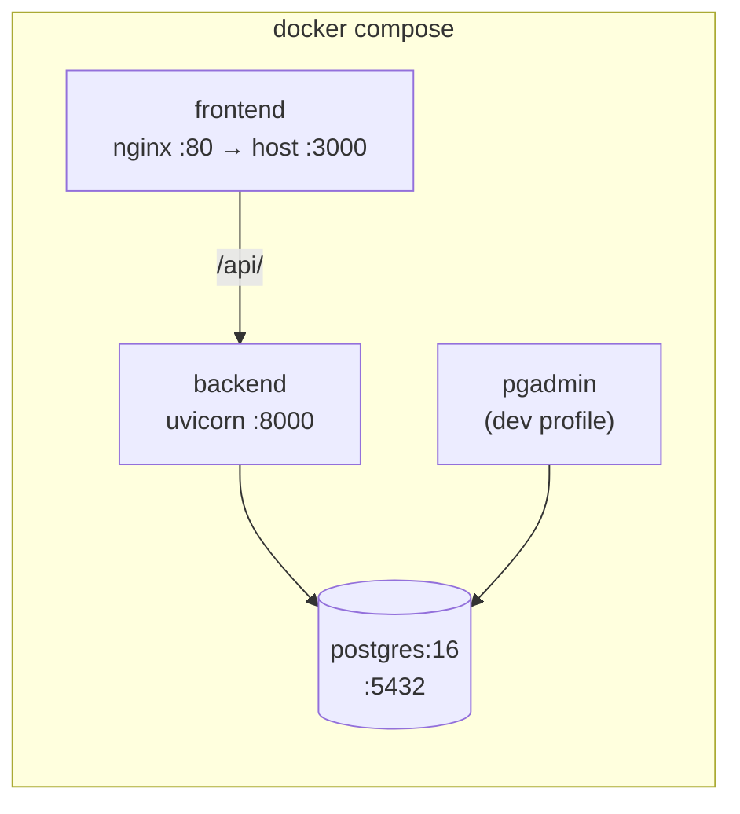

# Architecture

This document describes how EIBO is put together as it exists in the repository today: the runtime components, how a request flows through them, where state lives, and which parts are wired into the running application versus available as libraries.

> **Status note.** EIBO has two analytics tiers.
>
> - The **web application** (React + FastAPI) serves every page from `backend/services/`.
> - The **analytics library** (`models/`, `optimization_engine/`, `strategic_planner/`, `forecasting/`) contains the full ML and ILP implementations and is covered by the unit tests.
>
> The API calls the library for **impact scoring** (`models/impact_scorer.py` and `models/network_analysis.py`, through `backend/services/scoring.py`) and for **forecasting**. Attrition risk is still a demo heuristic, and the web simulation uses its own ILP. See [Lessons Learned](LESSONS_LEARNED.md#1-two-analytics-tiers-drifted-apart).

---

## 1. System context



Everything runs on infrastructure the organization controls. The only outbound calls the backend can make are to registered webhook URLs (validated against private/loopback addresses) and to a local Ollama instance.

---

## 2. Runtime components

| Component | Location | Responsibility |
|---|---|---|
| **Frontend** | `frontend/src/` | React 18 + TypeScript SPA. 19 pages, lazy-loaded per page. Zustand store holds the selected scenario and org size. All HTTP goes through `services/api.ts`. |
| **API layer** | `backend/main.py`, `backend/routers/` | FastAPI app with 19 routers mounted under `/api`. Pydantic models validate every request (scenario `A/B/C`, size `small/medium/large`). |
| **Service layer** | `backend/services/` | One module per capability (OHI, pulse, fairness, resilience, L&D, …). Each takes a cached synthetic org and returns JSON-ready dicts. |
| **Public API v1** | `backend/routers/v1.py` | Versioned read-only endpoints for external consumers. Bearer API keys, per-key token-bucket rate limiting, salary masking by scope. |
| **Platform services** | `api_key_service.py`, `webhook_service.py` | SHA-256 hashed keys (raw key shown once), HMAC-SHA256 signed webhook deliveries with an SSRF guard. |
| **Analytics library** | `models/`, `optimization_engine/`, `forecasting/`, `strategic_planner/` | Impact scoring, attrition prediction, network analysis, constrained ILP, Pareto and sensitivity sweeps, Prophet and Monte Carlo forecasting, skills-gap and transition planning. |
| **Enterprise modules** | `auth/`, `audit/`, `notifications/`, `workflows/`, `integration_hub/`, `health/` | Six-tier RBAC, JSONL audit trail, notification engine with channels, Prefect-compatible workflow engine, HRIS connectors (Workday, BambooHR, generic). |
| **Data pipeline** | `data_pipeline/` | Bronze → Silver → Gold ingestion with validators and a PostgreSQL schema. |
| **SDKs and widgets** | `sdk/`, `frontend/public/widgets/` | Stdlib-only Python client, ESM JavaScript client, four Web Component widgets. |
| **MCP server** | `mcp_server/` | Exposes the services to LLM clients as 13 read-only tools, 2 resources and 3 prompts. It calls `backend/services` in-process (no running API needed), enforces `auth/rbac.py` scope and salary masking, redacts names by default and audits every call. See [MCP Server](MCP_SERVER.md). |

---

## 3. Request lifecycle

A typical page load (for example, the OHI page) looks like this:



Key properties:

- **Deterministic.** The generator and every service use fixed seeds, so the same scenario and size always return the same numbers. That makes screenshots, tests and demos reproducible.
- **Cached per process.** `data_service._org_cache` holds at most 9 orgs (3 scenarios × 3 sizes). The first request for the 5,000-employee org takes about 30 s: roughly 15 s to generate it and 15 s to score it (collaboration graph, centrality and the impact model, cached in `backend/services/scoring.py`). After that it is served from memory.
- **Stateless routers.** Routers only validate and translate exceptions into HTTP status codes. All logic lives in services.

---

## 4. Frontend architecture

```
frontend/src/
├── App.tsx              page switch + React.lazy per page (Suspense fallback)
├── components/          Nav (grouped dropdowns, theme toggle), Footer
├── pages/               19 pages, one per capability
├── services/api.ts      typed fetch wrappers + response interfaces
├── stores/demoStore.ts  Zustand: scenario + org size
└── styles/tokens.css    design tokens, light/dark themes
```

- **Navigation is state-based**, not URL-based: `App.tsx` keeps the current page in `useState` and renders it. This keeps the SPA simple but means pages cannot be deep-linked.
- **Code splitting**: each page is a separate chunk. The initial bundle is about 243 kB (80 kB gzip) instead of a single 607 kB bundle.
- **Styling** uses inline `React.CSSProperties` with CSS custom properties from `tokens.css`. Dark mode swaps token values under `html[data-theme="dark"]`.
- **Charts are hand-written SVG**, so there is no chart-library dependency.

In development, Vite proxies `/api` to `localhost:8000`. In Docker, nginx serves the static build and proxies `/api/` to the `backend` service.

---

## 5. Data architecture

### Synthetic organizations (what the app runs on)

`demo_data/generator.py` produces a complete organization: employees, teams, skills, employee-skill matrix, quarterly KPIs and a collaboration network. Three scenarios (A growing, B restructuring, C merger) × three sizes (50, 500, 5,000 employees). Some employees are deliberately designated as network "nexus" nodes so that structural-risk features have something to find.

### Medallion pipeline (for real data)

```
CSV / HRIS API ─► Bronze (raw, write-once) ─► Silver (cleansed, idempotent) ─► Gold (aggregates)
```

`data_pipeline/bronze_ingest.py`, `silver_cleanse.py` and `gold_aggregate.py` implement the layers. `schema.sql` initializes PostgreSQL in Docker. The web application does not read from this pipeline yet: every page serves the synthetic orgs, and most endpoints answer `demo=false` with `501 Not Implemented`.

### Where state lives

| State | Store | Durability |
|---|---|---|
| Generated orgs | In-process dict | Lost on restart; regenerated deterministically |
| API keys, webhooks | In-process dict | Lost on restart (demo design) |
| Decision Room sessions | `backend/data/decision_rooms.json` | Persisted to disk |
| Audit events | `audit_logs/audit.jsonl` + in-memory ring buffer (5,000) | Persisted, append-only |
| Narrative cache | In-process dict, keyed per day | Lost on restart |

---

## 6. Optimization architecture

Two ILP implementations exist:

1. **`optimization_engine/ilp_solver.py`** (library). Maximizes Σ impactᵢ·xᵢ subject to budget, at least one leader per team, critical-skill coverage, optional succession depth and minimum team size, plus force-retain and exclude overrides. `multi_objective.py` sweeps budget fractions to build a Pareto frontier; `sensitivity.py` re-solves at ±5/10/20%.
2. **`backend/services/data_service.run_simulation`** (web app). Maximizes impact under the budget with force-retain and exclude overrides, plus optional leadership coverage (one leader per team) and critical-skill coverage (one holder per critical skill). It returns coverage for both, diagnoses which constraint makes a budget infeasible, and falls back to a constraint-aware greedy heuristic if PuLP is unavailable. Succession depth and minimum team size exist only in the library solver.

Both use the CBC solver bundled with PuLP 3.x. PuLP is pinned below 4 because 4.x removes the bundled solver and changes the modeling API.

---

## 7. Security architecture

| Concern | Control |
|---|---|
| Input validation | Pydantic models and `Query(pattern=...)` on every scenario/size parameter |
| Public API auth | Bearer key, SHA-256 hash lookup with constant-time comparison, token-bucket rate limit |
| Salary exposure | v1 masks `annual_salary` unless key scope is manager, director or executive |
| Outbound requests | Webhook URLs must be http(s) and resolve to public IPs; redirects not followed |
| LLM privacy | Names replaced by `role-anonID` before any prompt; Ollama is local only |
| CORS | Explicit origin allow-list from `CORS_ORIGINS` |
| Supply chain | CI runs bandit, pip-audit and npm audit on every push |

Known gap: `/api/admin/*`, `/api/v1/api-keys` and `/api/v1/webhooks` have no authentication. The RBAC model in `auth/rbac.py` exists but is not enforced at the HTTP layer.

---

## 8. Deployment



- `backend/Dockerfile`: Python 3.11 slim, installs `requirements.txt`, runs uvicorn.
- `frontend/Dockerfile`: multi-stage, Node 20 build → nginx static serve.
- Health checks gate startup order (postgres → backend → frontend).
- CI builds both images on every push (see [Engineering](ENGINEERING.md#4-continuous-integration)).

---

## Related documents

- [Applied AI](APPLIED_AI.md): the models and algorithms behind each capability
- [Engineering](ENGINEERING.md): code organization, testing, CI, performance work
- [Business Value](BUSINESS_VALUE.md): what each capability is for
- [Lessons Learned](LESSONS_LEARNED.md): what went wrong and what we would do differently
