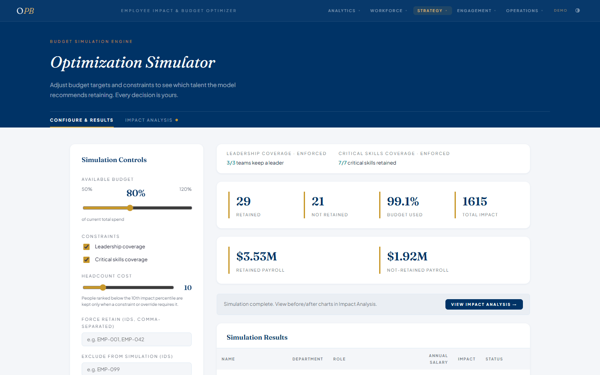
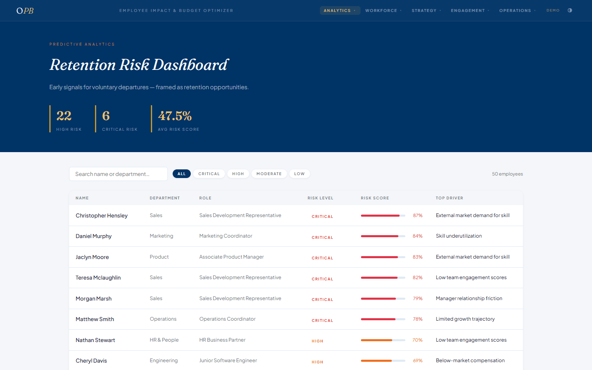
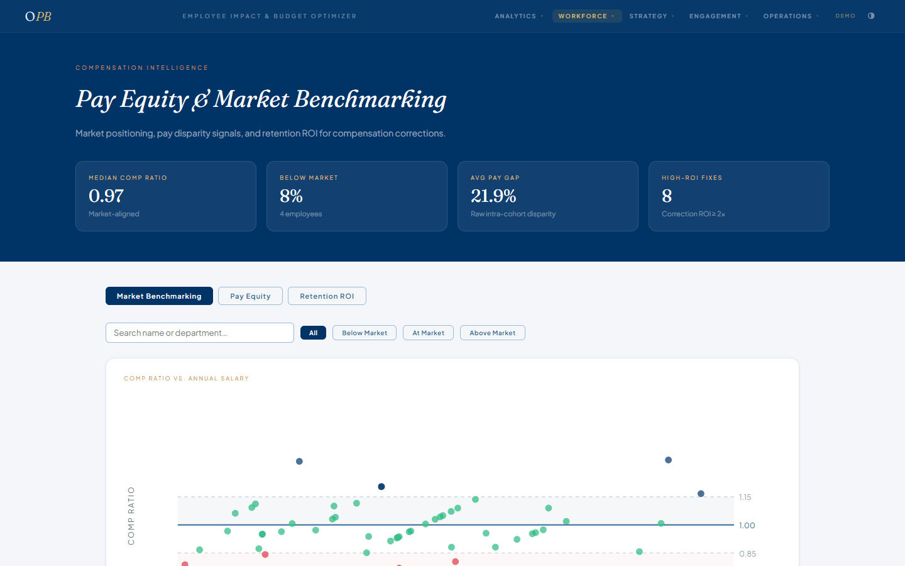
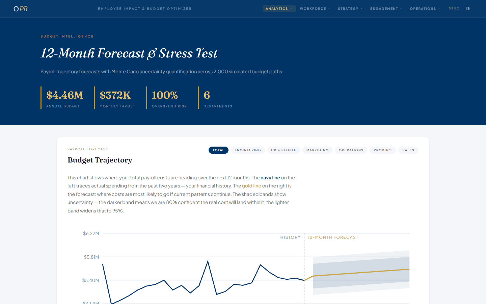

# Business Value

EIBO is decision support for one of the hardest calls an organization makes: how to fit its workforce into a budget without losing the people and structures it depends on. This document explains the problem, the decisions EIBO informs, and what each capability contributes, for leaders evaluating it rather than engineers building it.

> EIBO suggests; people decide. Every output is an input to a human decision, every suggestion can be overridden, and the language throughout is "suggested retention" and "not retained in simulation", never verdicts about people.

---

## 1. The problem

When a payroll budget has to change (a cost target, a hiring freeze, a merger, a year-end overrun), leaders usually decide with three inputs:

| Input | What it tells you | What it misses |
|---|---|---|
| Salary and headcount | What each person costs | What the organization loses if they leave |
| Performance ratings | Last year's evaluation | Structural value: the person who connects teams or is the only one who knows a critical system |
| Manager judgment | Deep context on known people | Consistency across departments, and the ability to hold many constraints at once |

The gap between "we need to spend 10% less" and "this combination of retained roles preserves the most capability" is where expensive mistakes happen: critical knowledge leaves, teams lose their only leader, and collaboration networks fragment silently.

---

## 2. Decisions EIBO informs

| Decision | Who asks it | Capabilities that answer it |
|---|---|---|
| *If payroll must fit 80% of current spend, which configuration keeps the most capability?* | CFO, CHRO | Simulation, Fairness, OHI preview |
| *Where are we over budget, and how likely is a breach next quarter?* | Finance | Dashboard, Forecast (Monte Carlo) |
| *Who is likely to leave, and what would help keep them?* | HRBPs, managers | Predictive, Pulse, Narrative |
| *Which people or teams are single points of failure?* | CHRO, department heads | Knowledge, Resilience, Drill-Down |
| *Are we paying fairly, and would this scenario create adverse impact?* | Compensation, Legal | Compensation, Fairness |
| *Where should the training budget go for the biggest return?* | L&D, HR | L&D Optimizer |
| *Who is ready to step up if a leader leaves?* | Talent management | Mobility (succession depth) |
| *How healthy is the organization overall, and is it improving?* | Executive team | OHI |

---

## 3. Capabilities and their value

### Plan and decide

- **Simulation.** A mathematical optimizer finds the set of retained roles that maximizes organizational impact within a budget. It can require that every team keeps a leader and every critical skill keeps a holder, and shows how well each plan covers both. A headcount-cost setting makes each seat count: the plan favors the highest-impact people over simply keeping the most people, and says when it leaves budget unused for that reason. Leaders can protect specific people or exclude them, and see the effect immediately. It replaces spreadsheet trial and error with an answer that is optimal for the stated constraints.
- **Decision Room.** Several stakeholders can review a scenario together, propose overrides, object, vote and sign off. Every step is recorded, so the final decision carries its own rationale.
- **Strategic.** Models a future-state organization and compares building skills internally with hiring for them.

### Understand risk

- **Predictive.** Ranks retention opportunities by risk band, with the main driver for each person. The goal is to reach people before they have decided to leave.
- **Pulse.** Watches six collaboration-metadata signals for early drift. It reads patterns, never message content, and is off by default for production use.
- **Knowledge.** Maps knowledge domains to the people who hold them and flags single knowledge holders, so cross-training can happen before an irreversible loss.
- **Resilience.** Stress-tests the organization: if these people left, who else would be likely to follow? It also shows which interventions reduce that cascade.

### Pay and fairness

- **Compensation.** Compares pay to market, separates explained from unexplained pay gaps, and shows where a retention adjustment has the best return.
- **Fairness.** Checks simulation outcomes against the EEOC four-fifths rule and for statistical significance before anyone acts. A flagged result is a prompt for investigation, not a legal conclusion.

### Financial outlook

- **Dashboard.** Budget vs spend by department, payroll mix, impact and risk in one view.
- **Forecast.** 12-month payroll projections with uncertainty bands, plus a 2,000-run stress test that gives the probability of exceeding budget each month.

### Grow and sustain

- **L&D Optimizer.** Allocates a training budget across employees and programs for the highest expected impact. It also shows where extra budget stops paying off.
- **Mobility.** Shows career-path options, stagnation risk and succession depth behind every leader.
- **OHI.** One health score across six dimensions (financial health, talent risk, knowledge resilience, leadership pipeline, compensation equity, collaboration density) with a 24-month trend and a "what would this decision do to our health" preview.
- **Narrative.** Turns scores into plain-language briefs a manager can use in a retention conversation. It runs on a local model and receives no names or salaries.

---

## 4. Who uses it

| Role | Primary use |
|---|---|
| CFO / Finance Director | Budget position, breach probability, optimization scenarios |
| CHRO / CPO | Organizational health, attrition trends, fairness review before acting |
| HR Business Partner | Department-level risk, compensation, pulse, narratives for managers |
| Line manager | Own team only: impact, risk and briefs for retention conversations |
| Legal / Compliance | Fairness audit and the audit trail as evidence of a structured, bias-checked process |
| People Analytics | Runs scenarios, owns data quality and model configuration |

---

## 5. Why this approach

- **Optimal, not just ranked.** Ranking people by value per dollar ignores that teams need leaders and critical skills need coverage. The optimizer respects those constraints, or shows that the budget makes them impossible.
- **Structural value becomes visible.** Network and knowledge analysis surface people whose importance does not show up in pay or ratings.
- **Uncertainty is explicit.** Forecasts are ranges, and risk scores are probabilities with stated drivers.
- **Private by design.** EIBO runs on the organization's own infrastructure. No employee data goes to third parties, including the language model.
- **Auditable.** Simulations, overrides and sign-offs are logged, which makes decisions explainable later to employees, boards and regulators.
- **No licensing cost.** The stack is entirely open source.

---

## 6. What it does not do

- **It does not make decisions.** It never selects individuals for departure; it models configurations of retained roles.
- **It does not know what it is not told.** Next quarter's project, a promise made to an employee and team dynamics all come from people, which is what overrides are for.
- **It does not predict individuals with certainty.** A 70% risk describes a profile, not a person's future.
- **It does not replace employment counsel.** Fairness and pay-equity findings need legal interpretation.
- **It is a demonstration platform today.** It runs on realistic synthetic organizations. Before using it for real decisions, an organization would need to:
  - connect real data through the ingestion pipeline;
  - switch the web app's attrition risk to the trained ML model (see [Applied AI](APPLIED_AI.md));
  - enforce role-based access on every endpoint.

---

## 7. Conditions for getting value

1. **Data quality first.** Inconsistent department taxonomies or missing tenure data flow straight into the outputs.
2. **A clear owner** responsible for the data, model configuration and interpretation.
3. **Managers who can act.** A risk score only helps if someone has the retention conversation.
4. **Integration into existing cycles.** Budget reviews, talent reviews and HRBP cadences are where the outputs belong.
5. **Willingness to act on fairness findings.** Running an audit and ignoring its result creates a documented risk instead of a safeguard.
